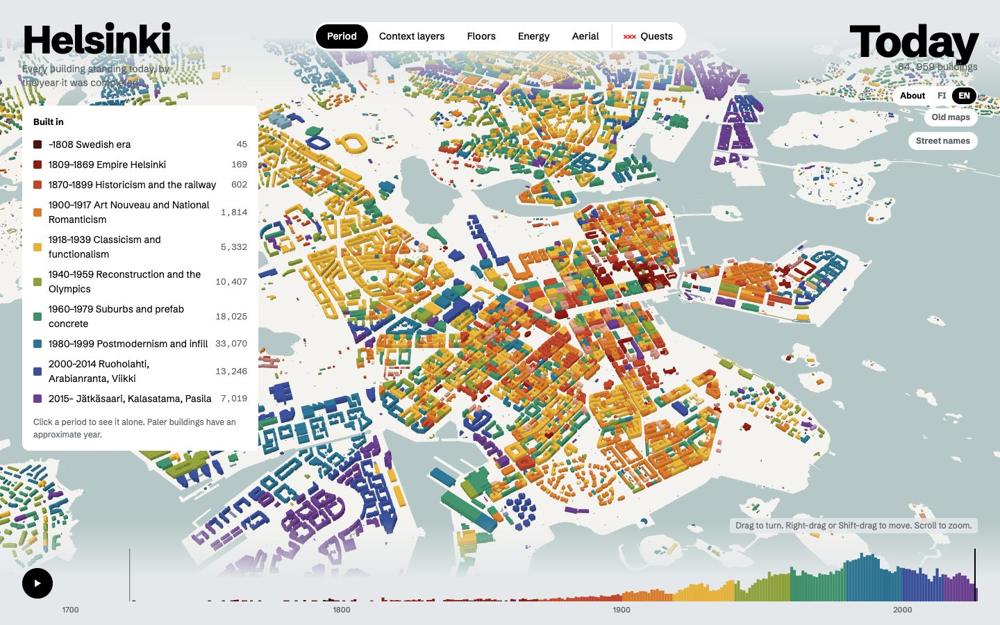
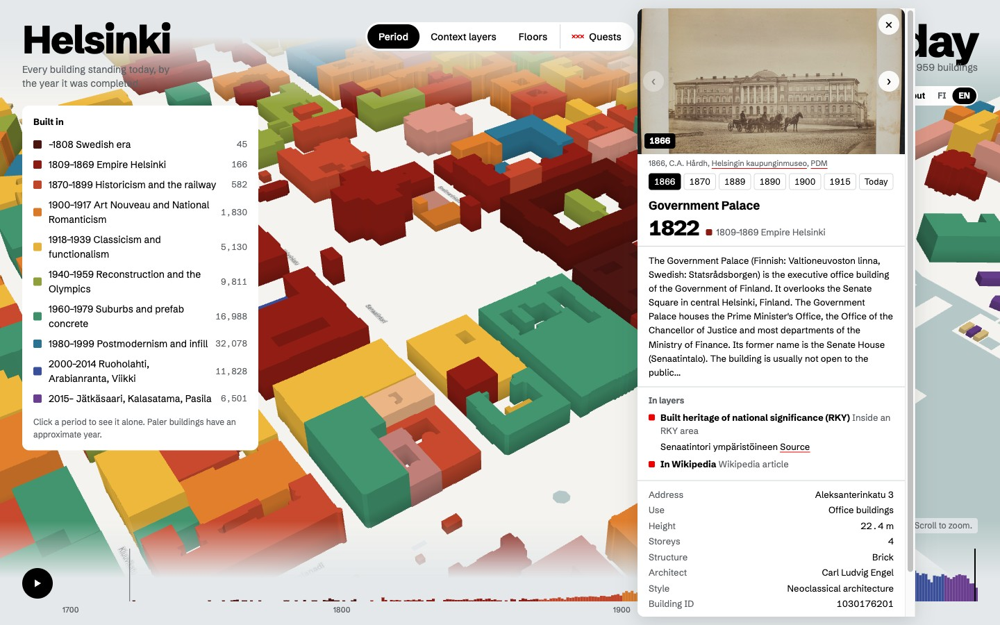
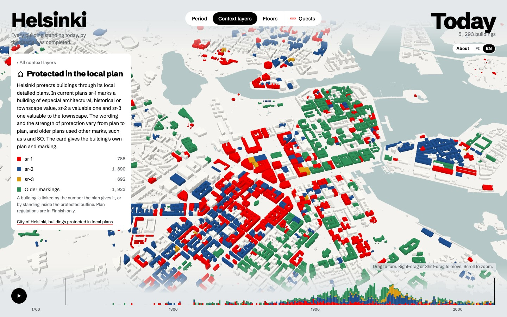
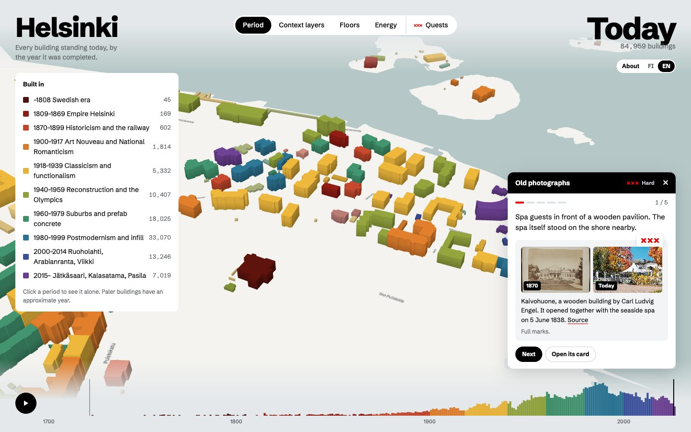
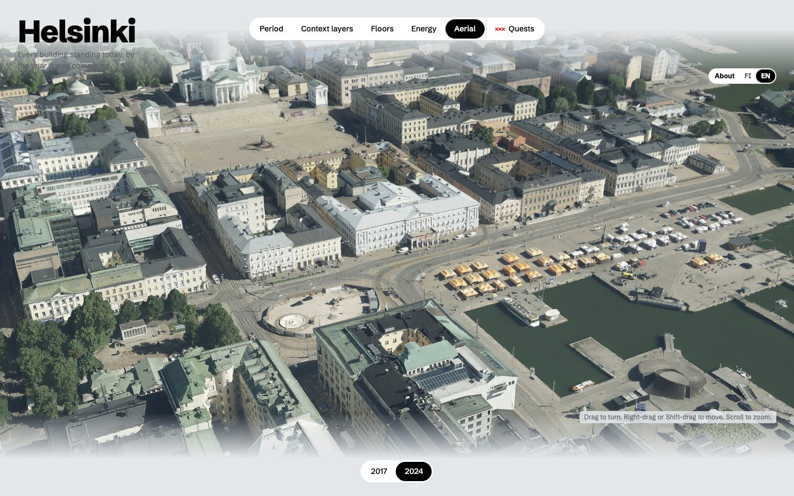
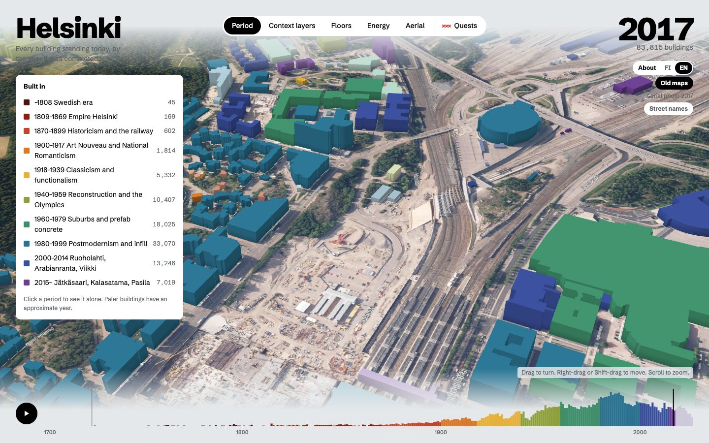
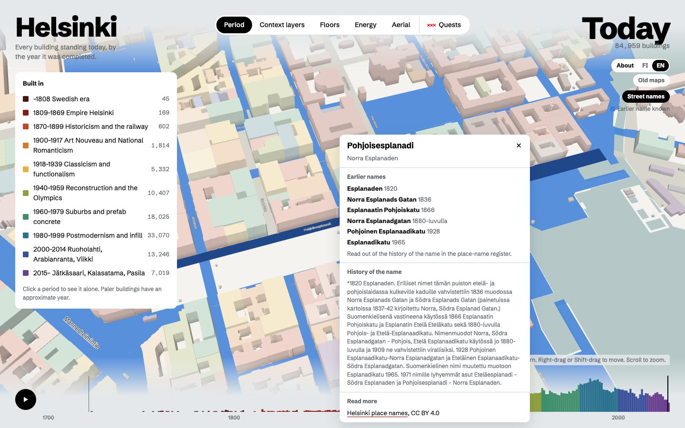
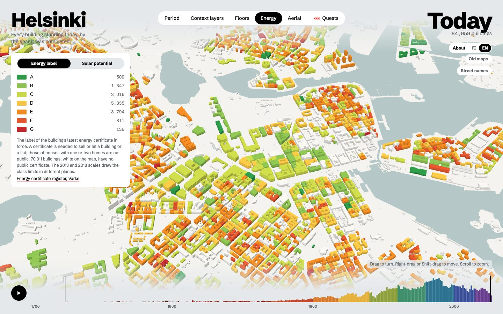
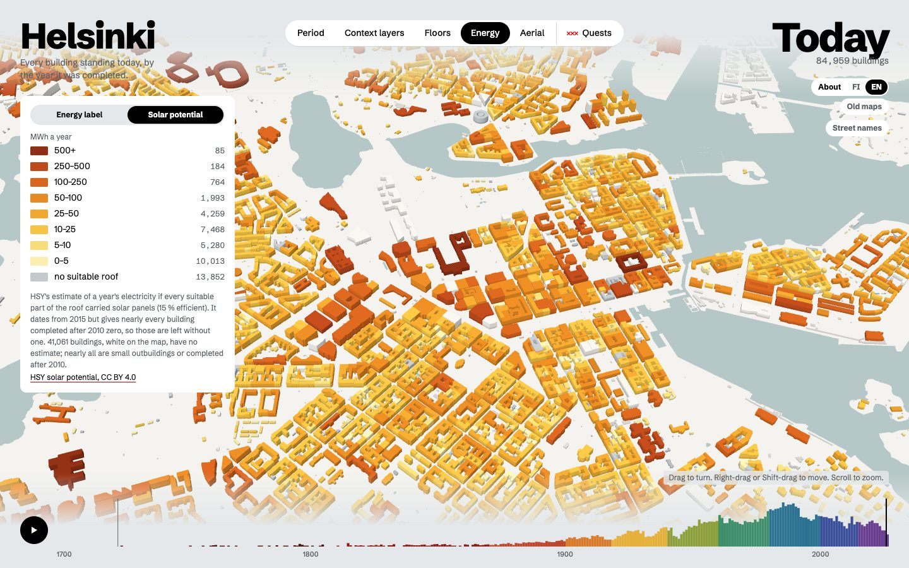
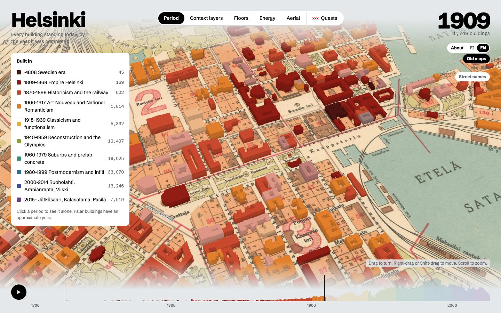

# Helsinki, building by building

Every building in Helsinki, 85,000 of them, coloured by the year it was completed. What the map shows:

- **Colourings.** By the period a building was completed, by its floors, by its energy label, or by how much solar
  power its roof could give.
- **Back in time.** The timeline plays the city's growth. Go back and the 4,800 buildings demolished since 2008 stand
  again, paler; the Torn down view shows them all at once in the colour of their age. The city's old maps
  (1749–1999) and aerial photos (1932–2025) can lie under the buildings, or be seen alone with the buildings hidden.
- **What Helsinki was meant to become.** The city's master plans and their proposals from 1923 to 2016 on the ground,
  and its road traffic noise as surveyed in 2012, 2017 and 2022.
- **Context layers.** The protection the city's plans give a building, the national heritage areas (RKY) it stands
  in, and the buildings in Wikipedia.
- **The building's card.** Use, height, floors, structure and facade, architect and style, the Wikipedia extract,
  the City Museum's photos of it through the years, its energy label and solar potential, and why its street is so
  named.
- **Aerial 3D.** The city's photogrammetric 3D model from its 2017 or 2024 aerial photos, in the same scene, from the
  Map menu.
- **Street names.** The streets laid on the ground and the buildings faded: streets that once had another name are
  blue, and a click on one gives its former names and the history they were read from.
- **War.** A view of each world war. The first: the land front Russia built around the city in 1914–1918, trench by
  trench as the city surveyed it in 1996, and the damage of the capture of Helsinki in 1918 in the City Museum's
  photos. The second: the anti-aircraft batteries and the bomb damage of 1939–1944. For both, the defences in
  Museovirasto's register and the memorials, each site with a card.
- **Quests.** Find buildings from riddles and old photos, and guess their age with the colours switched off.

A non-commercial project, made for curiosity and learning. It is a fork of Alexander Barakov's
[Amsterdam, building by building](https://github.com/alexbarakov/amsterdam-by-building) (MIT), which was inspired by
Sasha Bogachev's [Paris, building by building](https://paris.bogachev.fr); the architecture, a data pipeline feeding a
three.js city, follows theirs. The viewer in `web/` is Amsterdam's, with Helsinki's data, Finnish and English.



| The building's card: archive photos through the years | Context layer: protected in the local plan | Quests: find the building from an old photo |
|---|---|---|
|  |  |  |

| Aerial view: the city's 3D model from its 2024 aerial photos | Back to 2017: Pasila on that year's aerial photo, Tripla still a building site | Street names: the former names of Pohjoisesplanadi |
|---|---|---|
|  |  |  |

| Energy labels | Solar potential of the roofs | Old maps: the city of 1909 |
|---|---|---|
|  |  |  |

Screenshots of the map, which uses CC BY 4.0 data © City of Helsinki (buildings, the 3D model and its aerial meshes,
aerial photos, old maps, street areas and place names) and © HSY (solar potential), and the public energy
certificates of Varke's register. They show photos by C.A. Hårdh (Helsinki City Museum, public domain) and, in the
quest, Kaivohuone today by
[Marit Henriksson](https://commons.wikimedia.org/wiki/File:Kaivohuone_A_-Marit_Henriksson.jpg) (CC BY-SA 4.0).

## How it works

```
open data ──► pipeline/ (Python, uv) ──► web/data/ (binary tiles + JSON) ──► web/ (three.js, no build step)
```

| Step | What it does |
|---|---|
| `s00_fetch` | Downloads the City of Helsinki's WFS layers (buildings, land and water, protected buildings, street areas, address points, place names, the land front of 1914–1918), roof heights and demolished buildings from its 3D city model, Museovirasto's RKY areas and register of ancient and historic remains (and its page for each defence site), HSY's solar potential, the public energy certificates, Wikidata's buildings, the City Museum's photos in Finna and the city's public art |
| `s01_load` | Buildings, standing and demolished → `data/buildings.parquet`, one row per building, keyed by VTJ-PRT (or the city's or the model's feature id) |
| `s02_attributes` | Completion years (placeholders, rounded decades, missing years), floors, heights |
| `s03_tiles` | Packs 600 m tiles into 8 bundles, writes per-building attributes, addresses and the city config |
| `s04_water` | Water and land polygons |
| `s05_layers` | Context layers: protected in the local plan, RKY areas, buildings in Wikipedia; a bit per group per building |
| `s06_wiki` | Names, architects, styles, Wikipedia extracts and Commons photos for buildings with a Wikidata item |
| `s07_labels` | Street names placed along their street areas; why each street is so named and its former names; the street areas for the Street names view |
| `s08_archive` | Up to six Helsinki City Museum photos per building from Finna, matched by address |
| `s09_quests` | Resolves the quests (`quests.py`) to buildings and checks every claim against its Wikipedia article |
| `s10_energy` | Energy labels from the energy certificates and HSY's solar potential, by building |
| `s11_war` | The War view, by world war: the land front's lines (`trenches.bin`) and structures, Museovirasto's defence sites dated by their register pages, the City Museum's photos of war damage and the war memorials (`war.json`) |

## Run it

```bash
uv sync
for s in s00_fetch s01_load s02_attributes s05_layers s06_wiki s08_archive s09_quests s10_energy s03_tiles s04_water s07_labels s11_war; do uv run python -m pipeline.$s; done
uv run python -m pipeline.test_s02 && uv run python -m pipeline.test_s07 && uv run python -m pipeline.test_s08 && uv run python -m pipeline.test_s10 && uv run python -m pipeline.test_s11   # years, street names, addresses, energy, war
python3 -m http.server 8642 --directory web
```

Raw downloads (`data/`) and generated output (`web/data/`) are not in the repository: they are rebuilt by the pipeline.
The local frame is metres from Senaatintori (60.1694 N, 24.9527 E) in ETRS-GK25 (EPSG:3879), x east, z south.

## Data decisions

- **Years.** The year is the year of the register's completion date (`c_valmpvm`), read as written: the dates are local
  midnights (`1968-12-31T00:00:00+02:00`), and parsed to UTC they would slip into the year before.
- **Rounded decades.** Before 1930 the register rounds many dates to the decade: 1900 has 170 buildings against about
  33 a year around it, and 1850, 1880 and 1890 run five to ten times over too; from 1930 on the decades match their
  neighbours. So 1900 is not a placeholder like Amsterdam's 1905 but the oldest dates being approximate. On each
  round decade before 1930, as many buildings as the years around it predict keep their year; the rest (512 in all,
  demolished buildings included) are spread across the decade, drawn paler and marked "c." / "n.".
- **Missing years.** 34,652 buildings have no year and six carry the placeholder 1000 or 1001 (all on one property in
  Santahamina). Nearly all are sheds, storehouses, outbuildings, garages and summer cottages: buildings with a year
  hold 99.6% of the floor area. Their year is the median of the dated buildings on the same property
  (`c_kiinteistotunnus`, 759 buildings), else of the twelve nearest dated buildings (33,899: most of them are not
  linked to the register and have no property id). They are drawn paler, marked "c." / "n.", and the card says how
  the year was found.
- **Building types.** All 35 types are kept, 84,959 buildings. `Räystäs (stereo)` (438) looks like a roof edge
  rather than a building, but its polygons are buildings traced along the eaves in stereo aerial imagery, mostly in
  Östersundom and Santahamina: 436 of them overlap no other building, 128 are linked to the register (houses, a
  school, warehouses). Dropping them would remove real buildings.
- **Floors and heights.** Floors are the register's `i_kerrlkm`; 34,193 buildings, mostly the same small ones, have
  none. Heights come from the city's 3D city model (LoD2, served as 3D Tiles), linked by VTJ-PRT: 51,653 buildings.
  The model's own `measuredHeight` runs to the highest point, so as a flat block the Olympic Stadium would stand 73 m
  tall (its tower), the Railway Station 50 m and the Cathedral 59 m. Like Amsterdam's 3D BAG, the map instead takes
  the 70th percentile of the roof surfaces' height above the building's lowest point, weighted by area: 26 m, 21 m
  and 36 m; an ordinary block of flats changes little (14.3 m → 13.8 m). The tiles (about 650 MB) are read one by
  one and only the heights kept. Buildings the model does not link, nearly all small outbuildings, are floors × 3.2 m.
- **Use and materials.** The card shows the register's use class (`c_kayttark`, Statistics Finland's Building
  classification 1994) where there is one, else the base map's building type (`tyyppi`); the load-bearing material
  (`c_rakeaine`) and the facade material (`c_julkisivu`) from Helsinki's own code lists. Sources in `pipeline/codes.py`.
- **Protected buildings.** A building is in the layer when the plan's building number (`pys_raknro`) matches its
  register number, or when its representative point lies inside a protected outline: either alone misses some
  (441 and 77). Groups follow the marking: sr-1, sr-2 and sr-3 (variants such as sr-2a included) and older plans'
  marks (s, SO, AO/s, plain sr and others). There is no citywide legend: the wording differs from plan to plan, so the
  card shows each building's own plan, marking and the first sentence of its regulation (in Finnish). A building in
  several plans takes the strongest marking.
- **RKY.** Buildings are matched by location: everything inside an area lights up, new buildings included.
- **Wikidata.** Items are linked by the permanent building identifier (P3824 = VTJ-PRT): 4,641 items on 4,575
  buildings, 14 of them demolished. Most give a name and a completion year (which matches the register for 3,513 of 4,245 buildings; 148
  differ by more than ten years, mostly the register being later; not used). Extracts are the article's
  introduction cut at 450 characters. Oodi has no linked item: its Wikidata item carries no VTJ-PRT for this building.
- **Street names.** From the street areas of the register of public areas, placed as in Amsterdam: tier 1 (shown from
  afar) is the register's own class for main streets and motorways; streets not yet built are left out. Why a street
  is so named comes from the city's place-name register (`Nimisto_piste_rekisteritiedot`): its reason for the name
  and, for many, an older history of it, in Finnish only. 3,565 of the streets in the buildings' addresses or the
  street areas have one; a pinned card shows it for the street of the building's address.
- **Former street names.** The register keeps no earlier names as records of their own; they live only in its
  histories, mixed with proposals never adopted and with other streets' names. They were read out of the 3,560
  histories once by a language model (Claude), told to keep only names this street itself carried, never a proposal,
  a draft plan's name or another street's, and kept in `pipeline/former_names.json`: 1,069 names for 562 streets and
  places, with when the text says each was used. Cases the reading itself flagged as unsure were left out, as were
  forms that differ from today's name only by spaces or capitals (Freds Gatan for Fredsgatan); Hämeentie was corrected
  by hand, since its history begins with the old Tavastgatan on today's Snellmaninkatu. `s07_labels` keeps a name only
  while it stands word for word in its street's text, so a name read wrong cannot be one the text does not contain.
  The Street names view lays the 7,270 street areas on the ground, the 488 streets with a former name in blue, and
  fades the buildings, which then take no clicks; a click on a street opens its names, its reason and the full history
  they were read from.
- **Energy labels.** Varke's energy certificate register publishes every certificate in force as one CSV
  (146,383 in Finland); those of houses with one or two homes are not public. Matched by VTJ-PRT: 14,987 buildings,
  the one signed last where a building has several. The register offers the file for anyone to download but states no
  licence for it. The 2013 and 2018 scales place the class limits differently, so the card gives the scale with the
  E-value.
- **Solar potential.** HSY's photovoltaic potential (2015): the yearly output if every suitable part of the roof
  carried panels, 15 % efficient. Its building outlines are its own; each goes to the building of ours its inside
  point falls in, and several in one add up. Its outlines are newer than its estimates, which give zero to nearly
  every building completed after 2010 (2009: 28 %, as across the city; 2012: 69 %; 2015: 96 %), so those get none:
  43,898 buildings have an estimate, 30,046 above zero. Coloured in steps of 5, 10, 25, 50, 100, 250 and 500 MWh.
- **Archive photos.** All of the Helsinki City Museum's images in Finna are downloaded (about 83,000 records, 834
  pages) and matched by the address that ends their place (`subjectPlaces`), rather than searched address by address:
  a free-text search for "Aleksanterinkatu 52" returns hundreds of loose hits, while the place field names the
  address exactly. An address belongs to the building under the city's address point (the nearest within 15 m),
  else to the building whose register address it is; corner buildings get all their addresses this way. The
  museum's subject words rank the photos: buildings first, then street scenes, then the rest; interior-only photos
  are left out, as are photos older than the building. One photo a decade, at most six. Only PDM, CC0 and CC BY 4.0.
- **War.** A view of its own, like Street names: the buildings fade and take no clicks. Its menu in the bar shows the
  First (1914–1918) or the Second World War (1939–1945), all of its sites or one kind of them, never both wars at
  once; `s11_war` writes both. The land front, in the first: the city's
  survey of 1996 (`Maalinnoitus_kohteet`, 36,552 lines, 368 km) drawn as one-pixel lines coloured by what it found
  (still there 128 km, filled in or covered 34 km, destroyed 200 km, planned or not known 6 km), and its 1,683
  structures (`Maalinnoitus_yksikot`) as dots with their type, construction and later history, in the survey's
  Finnish. The lines are the survey's map strokes, so a trench is two. The 28 strongpoints are listed by number and
  named after the places Museovirasto's register gives their remains ("Tukikohta IV:10 (Kivikko)"). The register's
  defence sites in Helsinki go to the war its own page dates them to: its dating ("toinen maailmansota 1939–1945"),
  its kind of defence ("I maailmansodan varustukset", "I ms ja II ms varustus") or a description that opens on it
  ("Ensimmäisen maailmansodan aikainen luola…"); a war named only in passing does not count, as descriptions often
  point to a neighbouring site. That gives 50 sites to the first war and 14 to the second (Rysäkari to both), and leaves 74 older or
  undated ones (Suomenlinna, the Crimean War's batteries, and a few clearly of the first war such as Isosaari, whose
  pages say so only in passing). The register's 298 records of the land front's strongpoints are left to the survey.
  War damage: the City Museum's photos in Finna from 1914–1918 and 1939–1945 whose title or subject words name both
  damage and the war ("pommitusvaurioita", "Helsingin valtaus"), not shelters, splinter boards or aircraft, placed at
  the city's address point for the address the museum gives; one dot per address (17 addresses and 62 photos of 1918,
  25 and 34 of the second war). Photos with no house number are left out. Memorials: 19 works picked by hand from
  the city's 475 public artworks in the Service Map (the ids and names in `s11_war.py`), the Civil War of 1918 with the
  first war, with HAM's text shortened to its first sentences; the photos are not openly licensed, so the card links
  the Service Map instead. Wikidata types Helsinki's memorials as plain memorials, which is why it is not used.
- **Quests.** Three walks (easy, medium, hard) in `pipeline/quests.py`, written for this map. `s09_quests` drops any
  step whose claims are not word for word in its Wikipedia article, whose place is not found, or whose year is not
  the map's year for the building. The hard walk uses 1800s photos from the City Museum as clues; Oodi, Kiasma and the
  National Theatre are reached by their address, since Wikidata does not link them to their buildings.
- **Demolished buildings.** The 3D city model keeps the buildings demolished since 2008 as a layer of its own (LoD1,
  3D Tiles): 4,815, each with its year of demolition (2008–2026, most from 2016 on) and about half with a year of
  construction, a height, a use and a VTJ-PRT. `s01_load` takes each outline from the union of its roof's triangles;
  where the register lists the same building unchanged, the outlines meet to within a metre. The 13 the register still lists
  are left to the register, and 32 with no roof are dropped: 4,770 remain. A missing year is estimated as for the
  register's buildings, and always falls before the demolition. They stand from their year to the year they were
  torn down, paler than the buildings of today, and count in the tally for those years; they belong to no context
  layer. The card gives both years and links the 3D city model instead of the register. The Torn down view, which
  shares the Period button with the completion years, colours those gone by the timeline's year by the period they
  were built in and leaves every other building white; its tally counts the demolitions.
- **Map layers.** The Map menu, last in the bar (where Quests were; they moved beside About), lays a map under the
  buildings, streamed from the city's WMS (`kartta.hel.fi/ws/geoserver/avoindata/wms`, ETRS-GK25) in a quadtree of
  512 px tiles that splits where its pixels would show larger than the screen's. Its default, Scale model (Pienoismalli),
  is the white city with nothing under it, and Aerial 3D the aerial view below; each kind under the buildings opens a
  box at the side with a button for each year, which its title folds away. Old maps and
  orthophotos follow the timeline, the one of its year or the nearest before it; a click on a year takes the timeline
  there. Maps: 1749, 1780, 1820, 1838, 1870, 1878, 1900, 1909, 1917, 1925, 1940, 1952 and 1962 (the last three, like
  1917, show the centre only), and the guide maps (`Opaskartta_*`) of 1965, 1966, 1971, 1975, 1977, 1979, 1983,
  1985, 1987, 1989, 1991 and 1999; orthophotos: 1932, 1943, 1950, 1964, 1969, 1976, 1988, 1996, 2008, 2017, 2021
  and 2025. The other years cover only a strip of the city or leave holes, as measured on an overview of each layer;
  the 1800s plan is too faint to read. Plans stay whatever the year: the general plan for Greater Helsinki of 1923,
  the master plan proposals of 1932 (the central city) and 1960, the revised land use for 1980 drawn in 1972, and the
  master plans of 1992, 2002 and 2016. Noise is the road traffic noise by day (LAeq 7–22) of the surveys of 2012,
  2017 and 2022; 2007's covers part of the city on another scale and is left out. The server paints black outside a
  map's sheet and where a photo has nothing, and the map leaves black out; noise comes as PNG and is blended in where
  it is not clear, with a legend of the surveys' own colours (the server's own legend reads 55 for 65). The maps are
  georeferenced: Senaatintori falls on the square in each. The buildings and today's street names can be hidden to
  see a map alone.
- **Aerial view.** Aerial 3D, in the Map menu, streams the city's photogrammetric mesh from its 2017 or 2024 aerial photos
  (`kartta.hel.fi/3d/mesh/Helsinki_2017/`, `Helsinki_2024/2/`, 3D Tiles) into the same scene with
  [3d-tiles-renderer](https://github.com/NASA-AMMOS/3DTilesRendererJS); nothing is downloaded by the pipeline. The
  globe is turned to east, up and south at Senaatintori and by the grid's meridian convergence (−0.041°), which keeps
  it within 7 cm of ETRS-GK25 across the city; each tile is then stood upright and lifted by the earth's curvature
  (10 m at Vuosaari), so the sea reads 0 m in the centre and in Vuosaari alike. The 2024 mesh's heights are N2000
  already; 2017's are above the ellipsoid and are dropped by the geoid's 17.6 m, after which the two meshes agree to
  0.1 m in the centre and in Vuosaari. 2017's tiles state a tenth of the geometric error 2024's do for the same
  size of photo pixel, so it is refined to a screen error of 1.6 px instead of the default 16, which loads the two at
  the same sharpness and about the same memory. 2015's mesh is glTF 1.0, which three.js no longer reads, so it is not offered.
  A click finds the point it hits in the mesh and the building whose block stands under it.
- **Known differences.** Checked against five landmarks: the Cathedral (registered as Hallituskatu 7) 1852, the
  Sederholm house 1757, Kiasma 1998 and Oodi 2018 are right; the Railway Station gives 1909 (completed 1919).
  Not corrected by hand.

## Licence

Code: MIT (see [LICENSE](LICENSE)), © Alexander Barakov and contributors. Vendored in `web/vendor/`: three.js (MIT)
and 3d-tiles-renderer 0.5.3 (Apache 2.0, `web/vendor/3d-tiles-renderer/LICENSE`).

Data keeps the licence of its source:
- Buildings: City of Helsinki, [Helsingin rakennukset](https://hri.fi/data/en_GB/dataset/helsingin-rakennukset),
  WFS layer `avoindata:Rakennukset_alue_rekisteritiedot`. CC BY 4.0.
- Land and water: City of Helsinki, [Helsingin maa- ja vesialueet](https://hri.fi/data/en_GB/dataset/helsingin-maa-ja-vesialueet),
  WFS layers `Maavesi_manner`, `Maavesi_saaret`, `Maavesi_merialue`, `Maavesi_muut_vesialueet`. CC BY 4.0.
- Attribution, as the city asks: "Data and maps © City of Helsinki, City Survey Services" ("Data ja kartat (c) Helsingin
  kaupunki, kaupunkimittauspalvelut"). Downloaded via Helsinki Region Infoshare on 14 October 2026.
- Protected buildings: City of Helsinki, [Asemakaavoilla suojellut rakennukset ja alueet Helsingissä](https://hri.fi/data/fi/dataset/asemakaavoilla-suojellut-rakennukset-ja-alueet-helsingissa),
  WFS layer `Asemakaavoissa_suojellut_rakennukset_alue`. CC BY 4.0 (stated on HRI; the city's metadata record says
  only "free, public data").
- Street names: [Helsingin kaupungin yleisten alueiden rekisteri](https://hri.fi/data/fi/dataset/helsingin-kaupungin-yleisten-alueiden-rekisteri),
  WFS layer `YLRE_Katualue_alue`. CC BY 4.0. "Lähde: Helsingin kaupungin yleisten alueiden rekisteri. Aineiston
  ylläpitäjä on Helsingin kaupungin kaupunkiympäristön toimiala."
- The land front of 1914–1918: City of Helsinki, [Helsingin ensimmäisen maailmansodan aikaiset maalinnoitukset](https://hri.fi/data/fi/dataset/helsingin-ensimmaisen-maailmansodan-aikaiset-maalinnoitukset),
  a survey of 1996. CC BY 4.0.
- Defences of the two wars: Finnish Heritage Agency (Museovirasto), register of ancient and historic remains, WFS
  `rajapinta_suojellut:muinaisjaannos_piste` and `muu_kulttuuriperintokohde_piste`, and each site's page in the
  register (`kyppi.fi`) for its dating and description. CC BY 4.0.
- War damage: Helsinki City Museum's photos in Finna (as for the archive photos), public domain (PDM).
- War memorials: HAM Helsinki Art Museum's public art through the city's [Service Map](https://hri.fi/data/fi/dataset/paakaupunkiseudun-palvelukartan-rest-rajapinta)
  (`api.hel.fi/servicemap/v2`, service 767). Texts CC BY 4.0; the photos are HAM's and not used.
- RKY areas: Finnish Heritage Agency (Museovirasto), WFS `rajapinta_suojellut:rky_alue`. CC BY 4.0
  ([stated here](https://www.museovirasto.fi/fi/palvelut-ja-ohjeet/tietojarjestelmat/kulttuuriympariston-tietojarjestelmat/kulttuuriympaeristoen-paikkatietoaineistot));
  Museovirasto gives no attribution wording, so the map credits "Museovirasto, RKY, CC BY 4.0".
- Wikidata CC0. Wikipedia extracts CC BY-SA 4.0: each card links the article and the licence. Wikimedia Commons
  photos each under their own licence, credited with author and licence on the card.
- Heights: City of Helsinki, [Helsingin 3D-kaupunkimallit](https://hri.fi/data/fi/dataset/helsingin-3d-kaupunkimalli),
  the city information model's LoD2 buildings as 3D Tiles. CC BY 4.0. The model's WFS
  (`kartta.hel.fi/3d/citydb-wfs/wfs`) answered 503 on 14 October 2026; the 3D Tiles behind the city's own 3D viewer
  carry the same buildings and attributes.
- Demolished buildings: City of Helsinki, [Helsingin 3D-kaupunkimallit](https://hri.fi/data/fi/dataset/helsingin-3d-kaupunkimalli),
  the city information model's demolished LoD1 buildings as 3D Tiles. CC BY 4.0.
- Aerial view: City of Helsinki, [Helsingin 3D-kaupunkimallit](https://hri.fi/data/fi/dataset/helsingin-3d-kaupunkimalli),
  the photogrammetric meshes (kolmioverkkomalli) from 2017 and 2024 aerial photos, streamed from the city's server.
  CC BY 4.0.
- Map layers: City of Helsinki, [Helsingin ortoilmakuvat](https://hri.fi/data/fi/dataset/helsingin-ortoilmakuvat),
  [Helsingin historialliset kartat](https://hri.fi/data/fi/collection/helsingin-historialliset-kartat), the master
  plans ([2002](https://hri.fi/data/fi/dataset/helsingin-yleiskaava-2002), [2016](https://hri.fi/data/fi/dataset/helsingin-yleiskaava-2016)
  and the older ones and the guide maps in the city's open WMS layers) and
  [Helsingin kaupungin meluselvitykset](https://hri.fi/data/fi/dataset/helsingin-kaupungin-meluselvitys-2017), WMS
  layers `avoindata:Ortoilmakuva_*` and the others named in `web/app.js`, streamed from the city's map server. CC BY 4.0.
- Why streets are so named: City of Helsinki, [Helsingin nimistö](https://hri.fi/data/fi/dataset/helsingin-nimisto),
  WFS layer `Nimisto_piste_rekisteritiedot`. CC BY 4.0. `pipeline/former_names.json` is read out of its histories and
  shares its licence.
- Energy labels: Varke (Valtion tukeman asuntorakentamisen keskus), the public CSV of the
  [energy certificate register](https://www.energiatodistusrekisteri.fi/), downloaded on 14 October 2026. No licence stated.
- Solar potential: HSY, [Pääkaupunkiseudun aurinkosähköpotentiaali](https://hri.fi/data/fi/dataset/paakaupunkiseudun-aurinkosahkopotentiaali),
  WFS layer `ilmasto_ja_energia:rakennukset_aurinkosahkopotentiaali`. CC BY 4.0.
- Archive photos: Helsinki City Museum (Helsingin kaupunginmuseo) via the [Finna API](https://api.finna.fi). Public
  domain mark or CC BY 4.0, per photo. The museum asks that the photographer and Helsingin kaupunginmuseo are named;
  the card does, links the Finna record and loads the image from Finna. The app stores only record ids, years,
  photographers and licences.
- Use classes: Statistics Finland, Building classification 1994. English names of the material codes: the national
  Ryhti code lists (koodistot.suomi.fi).
