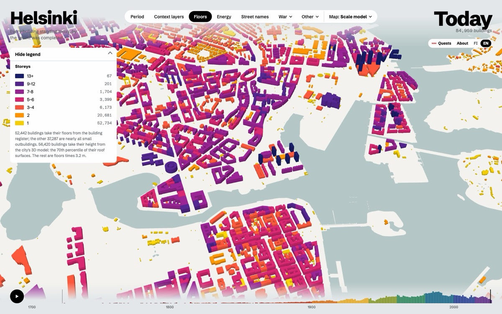
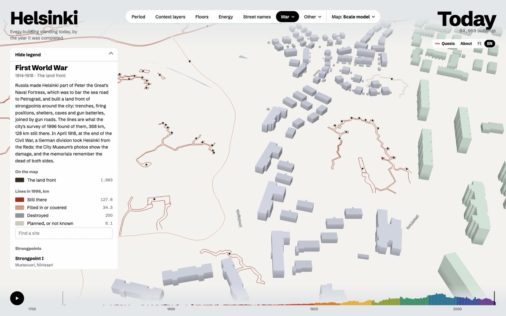
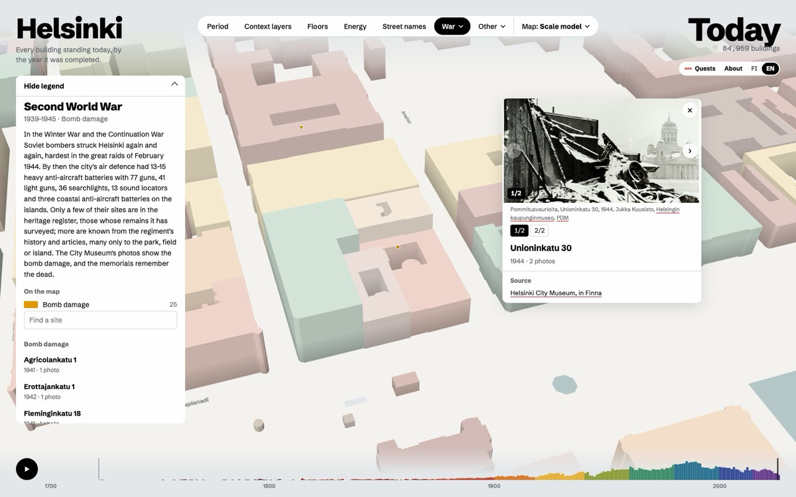
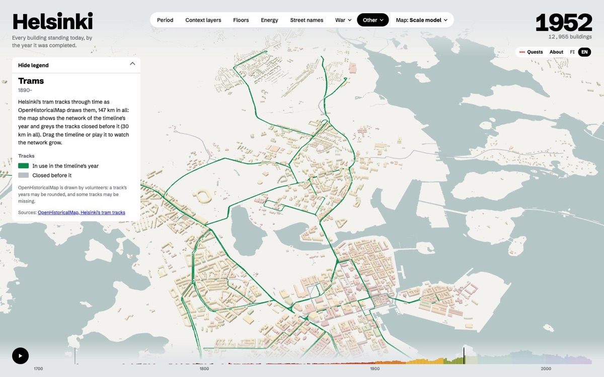
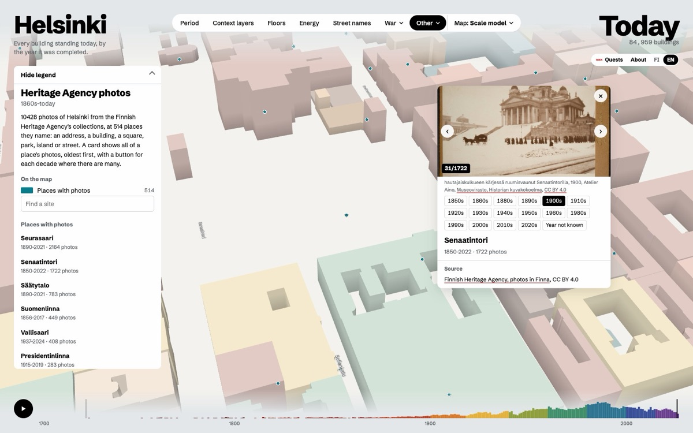
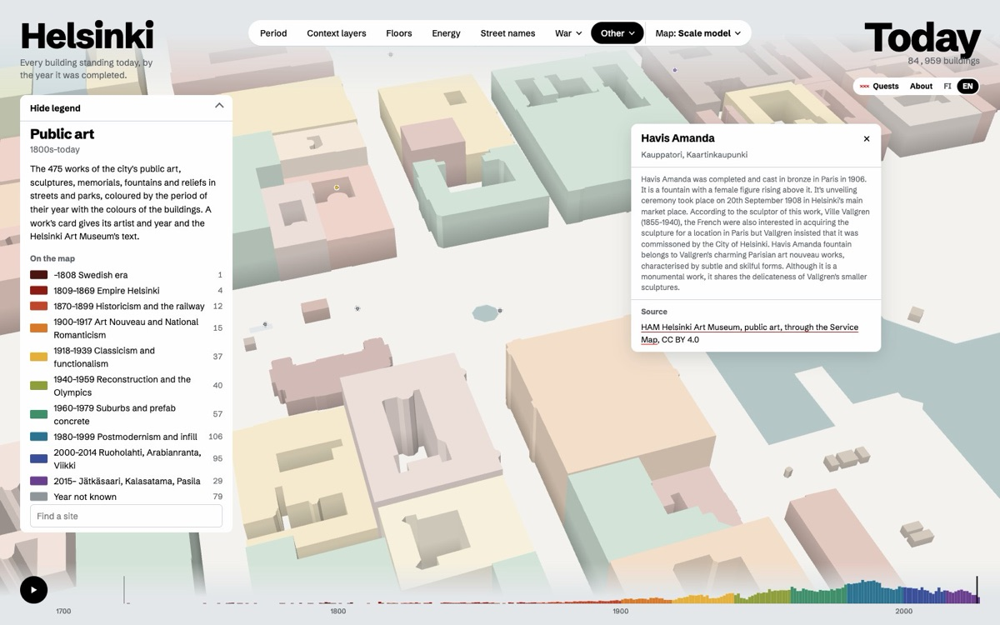
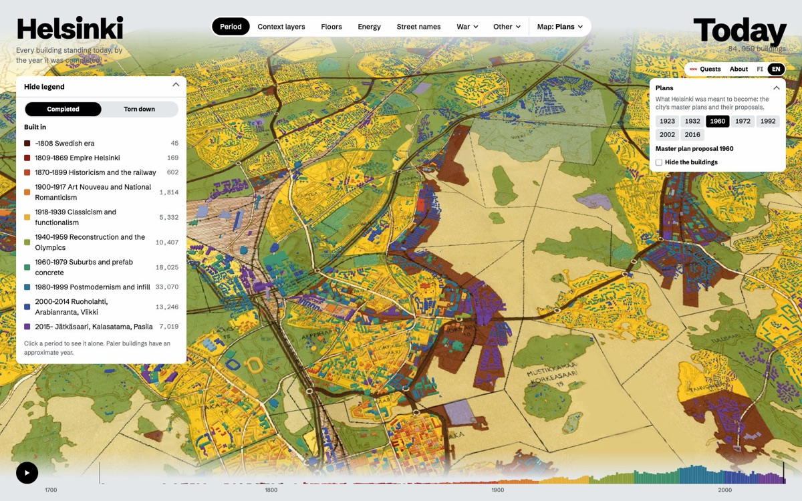
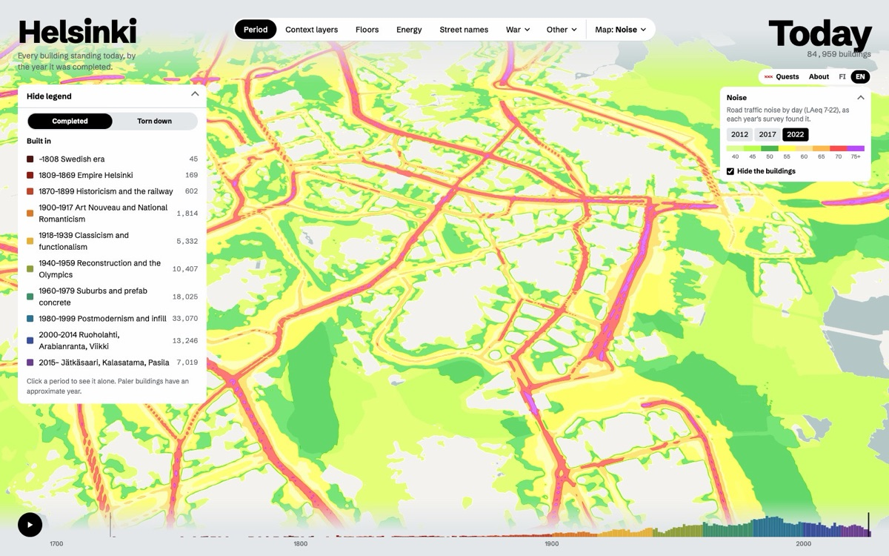

# Helsinki, building by building

**[koodarikettu.github.io/helsinki-by-building](https://koodarikettu.github.io/helsinki-by-building/)**

Every building in Helsinki, 85,000 of them, coloured by the year it was completed. What the map shows:

- **Colourings.** By the period a building was completed, by its floors, by its energy label, by how much solar
  power its roof could give, or by the heat source the building register records for it.
- **Back in time.** The timeline plays the city's growth. Go back and the 4,800 buildings demolished since 2008 stand
  again, paler; the Torn down view shows them all at once in the colour of their age. The city's old maps
  (1749 to today) and aerial photos (1932–2025) can lie under the buildings, or be seen alone with the buildings hidden.
- **What Helsinki was meant to become.** The city's master plans and their proposals from 1923 to 2016 on the ground,
  and its road traffic noise as surveyed in 2012, 2017 and 2022.
- **Context layers.** The protection the city's plans give a building, the national heritage areas (RKY) it stands
  in, the buildings in Wikipedia, and who lived here: the homes of well-known people whose Finnish Wikipedia article
  names their Helsinki address, each with the sentence it says so in.
- **The building's card.** Use, height, floors, structure and facade, architect and style, the Wikipedia extract,
  the City Museum's photos of it through the years, its energy label and solar potential, and why its street is so
  named.
- **Aerial 3D.** The city's photogrammetric 3D model from its 2017 or 2024 aerial photos, in the same scene, from the
  Map menu.
- **Street names.** The streets laid on the ground and the buildings faded: streets that once had another name are
  blue, and a click on one gives its former names and the history they were read from.
- **War.** A view of each world war. The first: the land front Russia built around the city in 1914–1918, trench by
  trench as the city surveyed it in 1996, and the damage of the capture of Helsinki in 1918 in the City Museum's
  photos. The second: the anti-aircraft batteries, the bomb damage of 1939–1944 and the Defence Forces' own photos of
  the city at war (SA-kuva) at the places they name. For both, the defences in Museovirasto's register and the
  memorials, each site with a card.
- **Other.** The city's 475 works of public art, coloured by period; the tram network of the timeline's year, with the
  tracks closed before it in grey; the Finnish Heritage Agency's photos of Helsinki at the places they name; and the
  parking fines of 2014–2023, street by street and year by year, with their commonest reasons.
- **Quests.** Find buildings from riddles and old photos, and guess their age with the colours switched off.

A non-commercial project, made for curiosity and learning. It is a fork of Alexander Barakov's
[Amsterdam, building by building](https://github.com/alexbarakov/amsterdam-by-building) (MIT), which was inspired by
Sasha Bogachev's [Paris, building by building](https://paris.bogachev.fr); the architecture, a data pipeline feeding a
three.js city, follows theirs. The viewer in `web/` is Amsterdam's, with Helsinki's data, Finnish and English.


| Floors, in seven steps | War: the land front of 1914–1918 | War: bomb damage of 1944 |
|---|---|---|
|  |  |  |

| Other: the tram network of 1952 | Other: the Heritage Agency's photos of Senate Square | Other: public art |
|---|---|---|
|  |  |  |

| Map: the master plan proposal of 1960 | Map: road traffic noise in 2022 | Map: the city of 1909 |
|---|---|---|
|  |  |  |

| The building's card: archive photos through the years | Context layer: protected in the local plan | Quests: find the building from an old photo |
|---|---|---|
|  |  |  |

| Aerial 3D: the city's model from its 2024 aerial photos | Back to 2017: Pasila on that year's aerial photo, Tripla still a building site | Street names: the former names of Pohjoisesplanadi |
|---|---|---|
|  |  |  |

| Energy labels | Solar potential of the roofs |
|---|---|
|  |  |

Screenshots of the map, which uses CC BY 4.0 data © City of Helsinki (buildings, the 3D model and its aerial meshes,
aerial photos, old maps, master plans, noise surveys, the land front's survey, street areas and place names) and © HSY
(solar potential), the public energy certificates of Varke's register, OpenHistoricalMap's tram tracks (CC0) and the
Helsinki Art Museum's text on Havis Amanda (CC BY 4.0). They show photos by C.A. Hårdh and Jukka Kuusisto (Helsinki
City Museum, public domain), by Atelier Aino (Finnish Heritage Agency, Historian kuvakokoelma, CC BY 4.0) and, in the
quest, Kaivohuone today by
[Marit Henriksson](https://commons.wikimedia.org/wiki/File:Kaivohuone_A_-Marit_Henriksson.jpg) (CC BY-SA 4.0).

## How it works

```
open data ──► pipeline/ (Python, uv) ──► web/data/ (binary tiles + JSON) ──► web/ (three.js, no build step)
```

| Step | What it does |
|---|---|
| `s00_fetch` | Downloads the City of Helsinki's WFS layers (buildings, land and water, protected buildings, street areas, address points, place names, the land front of 1914–1918, parking fines), roof heights and demolished buildings from its 3D city model, Museovirasto's RKY areas and register of ancient and historic remains (and its page for each defence site), HSY's solar potential, OpenHistoricalMap's tram tracks, the public energy certificates, Wikidata's buildings, the City Museum's, the Heritage Agency's and SA-kuva's photos in Finna and the city's public art |
| `s01_load` | Buildings, standing and demolished → `data/buildings.parquet`, one row per building, keyed by VTJ-PRT (or the city's or the model's feature id) |
| `s02_attributes` | Completion years (placeholders, rounded decades, missing years), floors, heights |
| `s03_tiles` | Packs 600 m tiles into 8 bundles, writes per-building attributes (the heat source among them), addresses and the city config |
| `s04_water` | Water and land polygons |
| `s05_layers` | Context layers: protected in the local plan, RKY areas, buildings in Wikipedia, who lived here; a bit per group per building |
| `s06_wiki` | Names, architects, styles, Wikipedia extracts and Commons photos for buildings with a Wikidata item |
| `s07_labels` | Street names placed along their street areas; why each street is so named and its former names; the street areas for the Street names view |
| `s08_archive` | Up to six Helsinki City Museum photos per building from Finna, matched by address |
| `s09_quests` | Resolves the quests (`quests.py`) to buildings and checks every claim against its Wikipedia article |
| `s10_energy` | Energy labels from the energy certificates and HSY's solar potential, by building |
| `s12_other` | The Other menu: public art by period, the tram tracks through time (`trams.bin`), the Heritage Agency's photos by place (`other.json`) and the parking fines by street and year (`fines.json`, loaded when the view opens) |
| `s11_war` | The War view, by world war: the land front's lines (`trenches.bin`) and structures, Museovirasto's defence sites dated by their register pages, the City Museum's photos of war damage, SA-kuva's photos by place (`saphotos/`, the photos scaled in `sathumbs/`) and the war memorials (`war.json`) |
| `s13_residents` | Well-known people at the Helsinki addresses their Finnish Wikipedia articles name, and Wikidata's links from people to buildings (`data/residents.json`, for `s05_layers`) |
| `s14_oldmaps` | The City Archives' maps of 1907 and 1902 placed by their control points (`oldmaps.json`) and cut into the ground's tiles (`oldmaps/`) |

## Run it

```bash
uv sync
for s in s00_fetch s01_load s02_attributes s13_residents s05_layers s06_wiki s08_archive s09_quests s10_energy s03_tiles s04_water s07_labels s11_war s12_other s14_oldmaps; do uv run python -m pipeline.$s; done
uv run python -m pipeline.test_s02 && uv run python -m pipeline.test_s07 && uv run python -m pipeline.test_s08 && uv run python -m pipeline.test_s10 && uv run python -m pipeline.test_s11 && uv run python -m pipeline.test_s12 && uv run python -m pipeline.test_s13 && uv run python -m pipeline.test_s14   # years, street names, addresses, energy, war, photos and fines, residents, old maps
python3 -m http.server 8642 --directory web
```

Raw downloads (`data/`) and generated output (`web/data/`) are not in the repository: they are rebuilt by the pipeline.
The site is `web/` with its generated data, less `web/data/tiles/` (the packs carry the tiles), on the `gh-pages`
branch, which GitHub Pages serves at the address above.
The local frame is metres from Senaatintori (60.1694 N, 24.9527 E) in ETRS-GK25 (EPSG:3879), x east, z south.

## Data decisions

- **Years.** The year is the year of the register's completion date (`c_valmpvm`), read as written: the dates are local
  midnights (`1968-12-31T00:00:00+02:00`), and parsed to UTC they would slip into the year before.
- **Rounded decades.** Before 1930 the register rounds many dates to the decade: 1900 has 170 buildings against about
  33 a year around it, and 1850, 1880 and 1890 run five to ten times over too; from 1930 on the decades match their
  neighbours. So 1900 is not a placeholder like Amsterdam's 1905 but the oldest dates being approximate. On each
  round decade before 1930, as many buildings as the years around it predict keep their year; the rest (512 in all,
  demolished buildings included) are spread across the decade, drawn paler and marked "c." / "n.".
- **Missing years.** 34,652 buildings have no year and six carry the placeholder 1000 or 1001 (all on one property in
  Santahamina). Nearly all are sheds, storehouses, outbuildings, garages and summer cottages: buildings with a year
  hold 99.6% of the floor area. Their year is the median of the dated buildings on the same property
  (`c_kiinteistotunnus`, 759 buildings), else of the twelve nearest dated buildings (33,899: most of them are not
  linked to the register and have no property id). They are drawn paler, marked "c." / "n.", and the card says how
  the year was found.
- **Building types.** All 35 types are kept, 84,959 buildings. `Räystäs (stereo)` (438) looks like a roof edge
  rather than a building, but its polygons are buildings traced along the eaves in stereo aerial imagery, mostly in
  Östersundom and Santahamina: 436 of them overlap no other building, 128 are linked to the register (houses, a
  school, warehouses). Dropping them would remove real buildings.
- **Floors and heights.** Floors are the register's `i_kerrlkm`; 34,193 buildings, mostly the same small ones, have
  none. Heights come from the city's 3D city model (LoD2, served as 3D Tiles), linked by VTJ-PRT: 51,653 buildings.
  The model's own `measuredHeight` runs to the highest point, so as a flat block the Olympic Stadium would stand 73 m
  tall (its tower), the Railway Station 50 m and the Cathedral 59 m. Like Amsterdam's 3D BAG, the map instead takes
  the 70th percentile of the roof surfaces' height above the building's lowest point, weighted by area: 26 m, 21 m
  and 36 m; an ordinary block of flats changes little (14.3 m → 13.8 m). The tiles (about 650 MB) are read one by
  one and only the heights kept. Buildings the model does not link, nearly all small outbuildings, are floors × 3.2 m.
- **Use and materials.** The card shows the register's use class (`c_kayttark`, Statistics Finland's Building
  classification 1994) where there is one, else the base map's building type (`tyyppi`); the load-bearing material
  (`c_rakeaine`) and the facade material (`c_julkisivu`) from Helsinki's own code lists. Sources in `pipeline/codes.py`.
- **Protected buildings.** A building is in the layer when the plan's building number (`pys_raknro`) matches its
  register number, or when its representative point lies inside a protected outline: either alone misses some
  (441 and 77). Groups follow the marking: sr-1, sr-2 and sr-3 (variants such as sr-2a included) and older plans'
  marks (s, SO, AO/s, plain sr and others). There is no citywide legend: the wording differs from plan to plan, so the
  card shows each building's own plan, marking and the first sentence of its regulation (in Finnish). A building in
  several plans takes the strongest marking.
- **RKY.** Buildings are matched by location: everything inside an area lights up, new buildings included.
- **Wikidata.** Items are linked by the permanent building identifier (P3824 = VTJ-PRT): 4,641 items on 4,575
  buildings, 14 of them demolished. Most give a name and a completion year (which matches the register for 3,513 of 4,245 buildings; 148
  differ by more than ten years, mostly the register being later; not used). Extracts are the article's
  introduction cut at 450 characters. Oodi has no linked item: its Wikidata item carries no VTJ-PRT for this building.
- **Who lived here.** `s13_residents` takes the 10,324 people Wikidata ties to Helsinki (born, died, lived or worked
  there) who have a Finnish Wikipedia article, and reads each article sentence by sentence. A sentence places its person
  at an address when it is about living, moving, being born, dying or working somewhere (asui, muutti, syntyi, kuoli,
  kotonaan, ateljee …) and not about a burial or about designing or building a house, names its person (the surname,
  in any case, or hän/he), names a street of Helsinki's address register with a house number, Helsinki or one of its
  districts is named in it or the three sentences before, and no other town in it: many towns have a Kauppakatu. Only
  217 sentences in the 10,324 articles name a Helsinki address at all. The other way round, the Finnish articles of the
  219 buildings Wikidata links by VTJ-PRT give the people linked in a sentence about living there ("Talossa asuivat mm.
  …"), when the sentence names the house and not a neighbour's, and the person is not named as someone's kin or in the
  genitive ("Bobrikovin leikannut kirurgi"), unless as their home ("Leinon koti"). Wikidata's own links from a person
  to a building add residences and places of work; its birth and death places, nearly all hospitals, are left out. A
  person is named as their article names them (Annie Edelfelt, not Wikidata's Alexandra), and the card quotes the
  sentence. 77 people at 62 buildings; a first pass gave 114, of which a reading by hand found about one in five wrong
  (architects, buyers, a neighbour, a party guest, a sentence about another house), which the rules above now leave
  out. Searching the articles for every street name too, as Amsterdam's map does, ran into Wikimedia's rate limits.
- **Street names.** From the street areas of the register of public areas, placed as in Amsterdam: tier 1 (shown from
  afar) is the register's own class for main streets and motorways; streets not yet built are left out. Why a street
  is so named comes from the city's place-name register (`Nimisto_piste_rekisteritiedot`): its reason for the name
  and, for many, an older history of it, in Finnish only. 3,565 of the streets in the buildings' addresses or the
  street areas have one; a pinned card shows it for the street of the building's address.
- **Former street names.** The register keeps no earlier names as records of their own; they live only in its
  histories, mixed with proposals never adopted and with other streets' names. They were read out of the histories by a
  language model (Claude), 2,658 streets and places whose text names another name, in eight batches read whole: a
  former name is one this same street carried before, in Finnish or Swedish, an official name or one confirmed in a
  plan and later changed, or a spelling that differs in its letters. Not one: a street joined to it ("Katu ulotettiin
  1953 käsittämään myös … Kalmistokadun": Kalmistokatu was never Mechelininkatu's name), a street it was split from or
  was part of ("Osa entistä Sörnäisten laituria"), a name another street bore (the old Tavastgatan of Hämeentie's
  history ran on today's Snellmaninkatu, and is Snellmaninkatu's), a proposal or a draft plan's name, a name only part
  of the street carried, a form differing from today's only by spaces or capitals (Freds Gatan for Fredsgatan), and
  anything the reading was unsure of. A first reading had taken joined and split streets for former names; read again,
  835 names for 458 streets and places remain: 248 of the first reading's are left out, 14 are new. Each name in
  `pipeline/former_names.json` carries when the text says it was used and the passage that shows it, and `s07_labels`
  keeps it only while that passage stands word for word in its street's text and names it. The Street names view lays
  the 7,270 street areas on the ground, the 389 streets with a former name in blue, and fades the buildings, which
  then take no clicks; a click on a street opens its names, its reason and the full history they were read from.
- **Energy labels.** Varke's energy certificate register publishes every certificate in force as one CSV
  (146,383 in Finland); those of houses with one or two homes are not public. Matched by VTJ-PRT: 14,987 buildings,
  the one signed last where a building has several. The register offers the file for anyone to download but states no
  licence for it. The 2013 and 2018 scales place the class limits differently, so the card gives the scale with the
  E-value.
- **Solar potential.** HSY's photovoltaic potential (2015): the yearly output if every suitable part of the roof
  carried panels, 15 % efficient. Its building outlines are its own; each goes to the building of ours its inside
  point falls in, and several in one add up. Its outlines are newer than its estimates, which give zero to nearly
  every building completed after 2010 (2009: 28 %, as across the city; 2012: 69 %; 2015: 96 %), so those get none:
  43,898 buildings have an estimate, 30,046 above zero. Coloured in steps of 5, 10, 25, 50, 100, 250 and 500 MWh.
- **Heat source.** The register's main heat source (`c_poltaine`, Helsinki's list RA_LAMMONLAHDE) and heating method
  (`c_lammtapa`, RA_LAMMITYSTAPA). The city's metadata says both are taken from the notice filed when a building is
  built, and that for buildings completed before 1981 they may be missing or wrong: it records what a building was
  built to be heated with, not necessarily what heats it now (651 buildings are still down as coal-heated, the median
  of their years 1954). The colouring groups the sources in five, so that their colours stay apart for colour-blind
  eyes too (checked with a palette validator, every pair, on the land's colour): district heating (28,090 standing
  buildings), electricity (9,992), ground-source heat (3,742), oil, light or heavy (3,495), and wood, coal, gas, peat or other
  (2,343). 37,297 have none recorded: 33,120 of them are not linked to the register at all, and 84 % are storehouses,
  sheds, outbuildings, summer cottages and garages. A click in the legend shows one source alone; the card gives the
  exact source and the method.
- **Archive photos.** All of the Helsinki City Museum's images in Finna are downloaded (about 83,000 records, 834
  pages) and matched by the address that ends their place (`subjectPlaces`), rather than searched address by address:
  a free-text search for "Aleksanterinkatu 52" returns hundreds of loose hits, while the place field names the
  address exactly. An address belongs to the building under the city's address point (the nearest within 15 m),
  else to the building whose register address it is; corner buildings get all their addresses this way. The
  museum's subject words rank the photos: buildings first, then street scenes, then the rest; interior-only photos
  are left out, as are photos older than the building. One photo a decade, at most six. Only PDM, CC0 and CC BY 4.0.
- **War.** A view of its own, like Street names: the buildings fade and take no clicks. Its menu in the bar shows the
  First (1914–1918) or the Second World War (1939–1945), all of its sites or one kind of them, never both wars at
  once; `s11_war` writes both. The land front, in the first: the city's
  survey of 1996 (`Maalinnoitus_kohteet`, 36,552 lines, 368 km) drawn as one-pixel lines coloured by what it found
  (still there 128 km, filled in or covered 34 km, destroyed 200 km, planned or not known 6 km), and its 1,683
  structures (`Maalinnoitus_yksikot`) as dots with their type, construction and later history, in the survey's
  Finnish. The lines are the survey's map strokes, so a trench is two. The 28 strongpoints are listed by number and
  named after the places Museovirasto's register gives their remains ("Tukikohta IV:10 (Kivikko)"). The register's
  defence sites in Helsinki go to the war its own page dates them to: its dating ("toinen maailmansota 1939–1945"),
  its kind of defence ("I maailmansodan varustukset", "I ms ja II ms varustus") or a description that opens on it
  ("Ensimmäisen maailmansodan aikainen luola…"); a war named only in passing does not count, as descriptions often
  point to a neighbouring site. That gives 50 sites to the first war and 14 to the second (Rysäkari to both), and leaves 74 older or
  undated ones (Suomenlinna, the Crimean War's batteries, and a few clearly of the first war such as Isosaari, whose
  pages say so only in passing). The register's 298 records of the land front's strongpoints are left to the survey.
  The register has few of the second war's air-defence sites (in February 1944 the city had 13–15 heavy batteries
  with 77 guns, 41 light guns, 36 searchlights and three coastal batteries, by the city's history portal), so 22 more
  positions are gathered by hand in `s11_war.py` from the regiment's history (Ahti Lappi's articles and slides, a
  National Defence University thesis), the Ilmatorjuntamuseo, Wikipedia and local papers, each placed at an address,
  a place in the city's place-name register or a memorial's coordinates, and each card saying how near that is and
  naming its source. Positions outside Helsinki and guesses are left out; the regiment's own maps of 1944 are too
  small in scale to place the rest.
  War damage: the City Museum's photos in Finna from 1914–1918 and 1939–1945 whose title or subject words name both
  damage and the war ("pommitusvaurioita", "Helsingin valtaus"), not shelters, splinter boards or aircraft, placed at
  the city's address point for the address the museum gives; one dot per address (17 addresses and 62 photos of 1918,
  25 and 34 of the second war). Photos with no house number are left out. Memorials: 19 works picked by hand from
  the city's 475 public artworks in the Service Map (the ids and names in `s11_war.py`), the Civil War of 1918 with the
  first war, with HAM's text shortened to its first sentences; the photos are not openly licensed, so the card links
  the Service Map instead. Wikidata types Helsinki's memorials as plain memorials, which is why it is not used.
  The city at war: the Defence Forces' photo archive (SA-kuva, the Military Museum's, CC BY 4.0) has 10,146 photos of
  1939–1945 in Finna that name Helsinki, nearly all with no place but the city. A photo is placed when its own place
  or its title names an address the city's address points know, a building Wikidata names or a spot in the place-name
  register, in any case form ("Silakoita Kauppatorilla", "Asemiesilta Kansallisteatterissa"): the forms are made for
  each name, with the consonant changes of its last word (katu → kadulla, saari → saaressa), and a form two places
  share finds neither. A district is too coarse and finds nothing, and so do eight names that are ordinary words or
  people's names in the titles (Prinssi, Sauna) or a town as well (Loppi). 1,562 photos at 195 places; the commonest
  places the archive names, the Messuhalli and the naval station, are in neither list, and are left out. Finna has
  no smaller size of the archive's photos than the originals, 4,900 px and 4–8 MB each, but scales one down when
  asked for a width (`w=600`, some 70 KB), as the map asks for every Finna photo; a photo Finna has not served before
  still takes it 3–9 s, while it fetches the original from the archive. So the pipeline has each placed photo scaled
  once (cached in `data/raw/sa_thumbs/`) and the map serves it itself. Finna is as slow over the other archives'
  photos, so an open card fetches the three photos after the one shown and the two before; the photo shown fades
  until the next has come.
- **Other.** A menu like War's, of views that lie on the ground (`s12_other`): public art, every work of the city's
  public art in the Service Map coloured by the period of the year in its credit ("Artist: Title, 1970"; 79 give
  none); the trams, OpenHistoricalMap's tram tracks (CC0, drawn by volunteers) with the years each opened and closed
  (two short stretches with no year at all are left out),
  drawn three pixels wide (three.js's LineSegments2, vendored) in green while in use in the timeline's year and in
  grey once closed; and the Finnish Heritage Agency's photos of Helsinki in Finna (CC BY 4.0, about 71,000), each at the
  most exact place it names: an address, a building Wikidata names, a spot in the city's place-name register (a
  square, park, island or street; not a district), or a point Finna gives other than the city's centre. Most name only
  the city or a district and are left out. One dot per place; the page carries each place's first photo, and its card
  loads all of them from one of 32 shards (`mvphotos/<nn>.json`, keyed by a CRC-32 of the place's name), oldest first,
  each crediting its photographer and collection, with a button for each decade past a dozen photos.
  The parking fines: the city's register of parking violations (Pysäköintivirheet Helsingissä, CC BY 4.0), 2023 from
  the WFS and 2014–2022 from its yearly files (`data/raw/fines/`), 139,000–166,000 fines and notices a year by the
  parking inspectors and the police. These are all the years there are: the data begin in January 2014, and the WFS,
  which was to carry the years from 2023 on, stops at 2023 (HRI's record last changed on 13 September 2024). Each fine
  is counted on the street of its address, matched to the street areas of the street-name view by name, letting
  capitals, spaces, hyphens, apostrophes and acute accents differ ("Kolmas linja" and "Kolmas Linja",
  "Katajanokanlaituri" and "Katajanokan laituri", "Castréninkatu" and "Castreninkatu"; not ä, ö or å) and dropping a
  square's "(tori tai aukio)". 3–7 % a year have no address or one the street areas lack (parks, stations, and streets
  such as Kalliosaarenkuja, Hammarskjöldintie and Kruununhaankatu that are not among them), and are left out, as are
  the 2023 fines the register marks as not at their real place (`todellinen_sijainti`; 2,565 of them under the parking
  control's own address in Pasila; the years before carry no such mark, and that address has 8–104 fines a year).
  Checked by counting again from the raw files with another reader (pandas): all 33,150 street-years agree, and each
  file's rows are its lines.
  A street is coloured by its fines in the timeline's year in eight steps (1, 5, 10, 25, 50, 100, 250 and 500+), in
  the noise surveys' own eight colours from 40 dB to 75+, light green through yellow and orange to red and violet, so
  that the two maps read alike and each step stands apart from the next (a one-hue red ramp tried first was too even
  to tell the steps apart); a street with none is a pale grey, and a picked street is blue. In this view the
  timeline holds to 2014–2023, a bar a year as tall as its fines, and the tally counts them; the buildings can be
  hidden. A card gives a street's fines year by year and the year's three commonest main reasons, in Finnish, codes
  cut off; the reasons are the register's own words, and a few are qualifiers rather than reasons ("Ei koske
  kuormaavia …").
  A long street gathers more fines than a short one, so the view also colours them per 100 m, in steps of under 1, 1,
  2, 5, 10, 25, 50 and 100+. A street's length is the sum of its built street areas' own lengths (`pituus`), or an area's
  size over its mean width where it gives none. Cycle and foot ways and parking areas (1,954 areas) run beside the
  carriageway rather than along it, and count only for a street that is nothing else: added in, Eteläinen
  Rautatiekatu would run 1,960 m rather than 636. Mannerheimintie comes to 6.0 km, Fredrikinkatu 1.5 km,
  Haartmaninkatu 343 m; 16 fined streets have no length and stay grey. Checked against the city's road centrelines
  (`Liikennevaylat`, the street ones whose middle lies in a street's areas): the median ratio is 0.98, half the
  streets within 0.93–1.01, and 88 % of the streets fined in 2023 within a factor of 1.5; the rest are mostly streets
  whose centrelines miss a pedestrian stretch (Mikonkatu) or run twice along a divided road. A stub of a few metres
  with a few fines would top the ranking, so per 100 m the panel ranks only streets of 100 m or more. `fines.json`
  (600 KB) comes when the view first opens.
- **Quests.** Three walks (easy, medium, hard) in `pipeline/quests.py`, written for this map. `s09_quests` drops any
  step whose claims are not word for word in its Wikipedia article, whose place is not found, or whose year is not
  the map's year for the building. The hard walk uses 1800s photos from the City Museum as clues; Oodi, Kiasma and the
  National Theatre are reached by their address, since Wikidata does not link them to their buildings.
- **Demolished buildings.** The 3D city model keeps the buildings demolished since 2008 as a layer of its own (LoD1,
  3D Tiles): 4,815, each with its year of demolition (2008–2026, most from 2016 on) and about half with a year of
  construction, a height, a use and a VTJ-PRT. `s01_load` takes each outline from the union of its roof's triangles;
  where the register lists the same building unchanged, the outlines meet to within a metre. The 13 the register still lists
  are left to the register, and 32 with no roof are dropped: 4,770 remain. A missing year is estimated as for the
  register's buildings, and always falls before the demolition. They stand from their year to the year they were
  torn down, paler than the buildings of today, and count in the tally for those years; they belong to no context
  layer. The card gives both years and links the 3D city model instead of the register. The Torn down view, which
  shares the Period button with the completion years, colours those gone by the timeline's year by the period they
  were built in and leaves every other building white; its tally counts the demolitions.
- **Map layers.** The Map menu, last in the bar (where Quests were; they moved beside About), lays a map under the
  buildings, streamed from the city's WMS (`kartta.hel.fi/ws/geoserver/avoindata/wms`, ETRS-GK25) in a quadtree of
  512 px tiles that splits where its pixels would show larger than the screen's. Its default, Scale model (Pienoismalli),
  is the white city with nothing under it, and Aerial 3D the aerial view below; each kind under the buildings opens a
  box at the side with a button for each year, which its title folds away. Old maps and
  orthophotos follow the timeline, the one of its year or the nearest before it; a click on a year takes the timeline
  there. Maps: 1749, 1780, 1820, 1838, 1870, 1878, 1900, 1907, 1909, 1917, 1920, 1925, 1935, 1940, 1952 and 1962
  (1917, 1920, 1935 and the last three show the centre only), and the guide maps (`Opaskartta_*`) of 1965, 1966, 1971,
  1975, 1977, 1979, 1983, 1985, 1987, 1989, 1991 and 1999, then the bird's-eye drawing of the inner city of 2014
  (`Kuvakartta`, the last dated map the city serves) and today's guide map (`Opaskartta_Helsinki`, kept up to date, on
  a button that reads Today); orthophotos: 1932, 1943, 1950, 1964, 1969, 1976, 1988, 1996, 2008, 2017, 2021
  and 2025. The other years cover only a strip of the city or leave holes, as measured on an overview of each layer;
  the 1800s plan is too faint to read. Three of the maps are not the city's. 1920 and 1935 are Wikimedia Commons scans
  as [Wikimaps Warper](https://warper.wmflabs.org/) georeferenced them (its maps 1206 and 1203): they fall between the
  city's 1917, 1925 and 1940, the years Töölö was built up. Warper's WMS serves no GK25, so each tile asks for the Web
  Mercator box between its corners (`gk25ToMerc` in `web/app.js`). By eye on today's guide map, Töölönlahti and
  Töölö's streets fall where they are today on both. Warper's other Helsinki maps are left out: 1893 and 1899 are the
  series of the city's 1900, 1924 is a year off 1925, 1815, 1845 and 1929 visibly miss Töölönlahti, 1932 is drawn
  at too small a scale and 1946 comes in twelve sheets. 1907 is the Helsinki City Archives' *Plan öfver Helsingfors
  stad och dess ägor* in Finna, placed by `s14_oldmaps` (below). Plans stay whatever the year: the competition entry
  for Töölö that Gustaf Nyström and Lars Sonck signed in June 1902 (the City Archives' too; the archive notes that it
  was not necessarily carried out), the general plan for Greater Helsinki of 1923, the master plan proposals of 1932
  (the central city) and 1960, the revised land use for 1980 drawn in 1972, and the
  master plans of 1992, 2002 and 2016. Noise is the road traffic noise by day (LAeq 7–22) of the surveys of 2012,
  2017 and 2022; 2007's covers part of the city on another scale and is left out. The server paints black outside a
  map's sheet and where a photo has nothing, and the map leaves black out; noise comes as PNG and is blended in where
  it is not clear, with a legend of the surveys' own colours (the server's own legend reads 55 for 65). The maps are
  georeferenced: Senaatintori falls on the square in each. The buildings and today's street names can be hidden to
  see a map alone.
- **The City Archives' maps.** Finna has the archive's scans of 1900–1909, Töölö's competition and plan drawings
  among them, but none georeferenced. `s14_oldmaps` places two by control points (`pipeline/oldmaps.json`, pixels
  of Finna's large image paired with ETRS-GK25) and cuts them into the ground's quadtree as JPEG tiles under
  `web/data/oldmaps/`, 11.6 MB together, black outside the sheet like the city's. The 1907 map's 718 points were
  matched by their features (OpenCV's SIFT, the ratio test and RANSAC) to the city's map of 1909, drawn at 2 m a
  pixel; a second-order polynomial holds them to 1.5 px (2.7 m) at the median, and today's street areas fall on its
  streets. Someone has drawn on it in red and blue by hand; the scan keeps that. In the hand-drawn 1902 entry SIFT
  finds too little (19 matches against the 1909 map, 9 against the 1900): it was first laid on the 1907 map by two
  points (Lapinlahti hospital and the sugar factory's long building), then 87 windows of 240 px were matched to the 1907 map by template matching on
  their edges, in the parts of the city that already stood (Kamppi, the shores, the railway); an affine fit holds
  them to 4.3 px (2.7 m) at the median, and Kamppi's streets fall on today's. The 1907 map goes to level 6 (2 m a
  pixel, the scan's own 1.8 m), the drawing to level 8 (0.5 m, the scan's 0.63 m); the map does not split a tile
  whose four children all fail to load, so it stops at a map's last level.
- **Aerial view.** Aerial 3D, in the Map menu, streams the city's photogrammetric mesh from its 2017 or 2024 aerial photos
  (`kartta.hel.fi/3d/mesh/Helsinki_2017/`, `Helsinki_2024/2/`, 3D Tiles) into the same scene with
  [3d-tiles-renderer](https://github.com/NASA-AMMOS/3DTilesRendererJS); nothing is downloaded by the pipeline. The
  globe is turned to east, up and south at Senaatintori and by the grid's meridian convergence (−0.041°), which keeps
  it within 7 cm of ETRS-GK25 across the city; each tile is then stood upright and lifted by the earth's curvature
  (10 m at Vuosaari), so the sea reads 0 m in the centre and in Vuosaari alike. The 2024 mesh's heights are N2000
  already; 2017's are above the ellipsoid and are dropped by the geoid's 17.6 m, after which the two meshes agree to
  0.1 m in the centre and in Vuosaari. 2017's tiles state a tenth of the geometric error 2024's do for the same
  size of photo pixel, so it is refined to a screen error of 1.6 px instead of the default 16, which loads the two at
  the same sharpness and about the same memory. 2015's mesh is glTF 1.0, which three.js no longer reads, so it is not offered.
  A click finds the point it hits in the mesh and the building whose block stands under it.
- **Known differences.** Checked against five landmarks: the Cathedral (registered as Hallituskatu 7) 1852, the
  Sederholm house 1757, Kiasma 1998 and Oodi 2018 are right; the Railway Station gives 1909 (completed 1919).
  Not corrected by hand.

## Licence

Code: MIT (see [LICENSE](LICENSE)), © Alexander Barakov and contributors. Vendored in `web/vendor/`: three.js (MIT)
and 3d-tiles-renderer 0.5.3 (Apache 2.0, `web/vendor/3d-tiles-renderer/LICENSE`).

Data keeps the licence of its source:
- Buildings: City of Helsinki, [Helsingin rakennukset](https://hri.fi/data/en_GB/dataset/helsingin-rakennukset),
  WFS layer `avoindata:Rakennukset_alue_rekisteritiedot`. CC BY 4.0.
- Land and water: City of Helsinki, [Helsingin maa- ja vesialueet](https://hri.fi/data/en_GB/dataset/helsingin-maa-ja-vesialueet),
  WFS layers `Maavesi_manner`, `Maavesi_saaret`, `Maavesi_merialue`, `Maavesi_muut_vesialueet`. CC BY 4.0.
- Attribution, as the city asks: "Data and maps © City of Helsinki, City Survey Services" ("Data ja kartat (c) Helsingin
  kaupunki, kaupunkimittauspalvelut"). Downloaded via Helsinki Region Infoshare on 14 October 2026.
- Protected buildings: City of Helsinki, [Asemakaavoilla suojellut rakennukset ja alueet Helsingissä](https://hri.fi/data/fi/dataset/asemakaavoilla-suojellut-rakennukset-ja-alueet-helsingissa),
  WFS layer `Asemakaavoissa_suojellut_rakennukset_alue`. CC BY 4.0 (stated on HRI; the city's metadata record says
  only "free, public data").
- Street names: [Helsingin kaupungin yleisten alueiden rekisteri](https://hri.fi/data/fi/dataset/helsingin-kaupungin-yleisten-alueiden-rekisteri),
  WFS layer `YLRE_Katualue_alue`. CC BY 4.0. "Lähde: Helsingin kaupungin yleisten alueiden rekisteri. Aineiston
  ylläpitäjä on Helsingin kaupungin kaupunkiympäristön toimiala."
- The land front of 1914–1918: City of Helsinki, [Helsingin ensimmäisen maailmansodan aikaiset maalinnoitukset](https://hri.fi/data/fi/dataset/helsingin-ensimmaisen-maailmansodan-aikaiset-maalinnoitukset),
  a survey of 1996. CC BY 4.0.
- Defences of the two wars: Finnish Heritage Agency (Museovirasto), register of ancient and historic remains, WFS
  `rajapinta_suojellut:muinaisjaannos_piste` and `muu_kulttuuriperintokohde_piste`, and each site's page in the
  register (`kyppi.fi`) for its dating and description. CC BY 4.0.
- War damage: Helsinki City Museum's photos in Finna (as for the archive photos), public domain (PDM).
- Tram tracks: [OpenHistoricalMap](https://www.openhistoricalmap.org/), CC0.
- Parking fines: City of Helsinki, [Pysäköintivirheet Helsingissä](https://hri.fi/data/fi/dataset/pysakointivirheet-helsingissa),
  WFS layer `Pysakointivirheet` (2023) and the yearly CSV files of 2014–2022. CC BY 4.0.
- The city at war: SA-kuva, the Military Museum's photo archive, in [Finna](https://www.finna.fi), CC BY 4.0, which asks
  that SA-kuva is named as the source; each card does, with the photographer where the archive knows them.
- Who lived here: Finnish Wikipedia, the sentence of each article that names the address (CC BY-SA 4.0, quoted and
  linked to the article), and Wikidata (CC0).
- Heritage Agency photos: Finnish Heritage Agency (Museovirasto) collections in [Finna](https://www.finna.fi), CC BY 4.0;
  each card credits the photographer and the collection.
- War memorials: HAM Helsinki Art Museum's public art through the city's [Service Map](https://hri.fi/data/fi/dataset/paakaupunkiseudun-palvelukartan-rest-rajapinta)
  (`api.hel.fi/servicemap/v2`, service 767). Texts CC BY 4.0; the photos are HAM's and not used.
- RKY areas: Finnish Heritage Agency (Museovirasto), WFS `rajapinta_suojellut:rky_alue`. CC BY 4.0
  ([stated here](https://www.museovirasto.fi/fi/palvelut-ja-ohjeet/tietojarjestelmat/kulttuuriympariston-tietojarjestelmat/kulttuuriympaeristoen-paikkatietoaineistot));
  Museovirasto gives no attribution wording, so the map credits "Museovirasto, RKY, CC BY 4.0".
- Wikidata CC0. Wikipedia extracts CC BY-SA 4.0: each card links the article and the licence. Wikimedia Commons
  photos each under their own licence, credited with author and licence on the card.
- Heights: City of Helsinki, [Helsingin 3D-kaupunkimallit](https://hri.fi/data/fi/dataset/helsingin-3d-kaupunkimalli),
  the city information model's LoD2 buildings as 3D Tiles. CC BY 4.0. The model's WFS
  (`kartta.hel.fi/3d/citydb-wfs/wfs`) answered 503 on 14 October 2026; the 3D Tiles behind the city's own 3D viewer
  carry the same buildings and attributes.
- Demolished buildings: City of Helsinki, [Helsingin 3D-kaupunkimallit](https://hri.fi/data/fi/dataset/helsingin-3d-kaupunkimalli),
  the city information model's demolished LoD1 buildings as 3D Tiles. CC BY 4.0.
- Aerial view: City of Helsinki, [Helsingin 3D-kaupunkimallit](https://hri.fi/data/fi/dataset/helsingin-3d-kaupunkimalli),
  the photogrammetric meshes (kolmioverkkomalli) from 2017 and 2024 aerial photos, streamed from the city's server.
  CC BY 4.0.
- Map layers: City of Helsinki, [Helsingin ortoilmakuvat](https://hri.fi/data/fi/dataset/helsingin-ortoilmakuvat),
  [Helsingin historialliset kartat](https://hri.fi/data/fi/collection/helsingin-historialliset-kartat), the master
  plans ([2002](https://hri.fi/data/fi/dataset/helsingin-yleiskaava-2002), [2016](https://hri.fi/data/fi/dataset/helsingin-yleiskaava-2016)
  and the older ones and the guide maps in the city's open WMS layers) and
  [Helsingin kaupungin meluselvitykset](https://hri.fi/data/fi/dataset/helsingin-kaupungin-meluselvitys-2017), WMS
  layers `avoindata:Ortoilmakuva_*` and the others named in `web/app.js`, streamed from the city's map server. CC BY 4.0.
- Old maps of 1920 and 1935: Wikimedia Commons, [Pharus-asemakaava Helsinki](https://commons.wikimedia.org/wiki/File:Pharus-asemakaava_Helsinki.jpg)
  (dated 1920 on Commons; public domain) and [Map of Helsinki-Helsingfors 1935](https://commons.wikimedia.org/wiki/File:Map_of_Helsinki-Helsingfors_1935.jpeg)
  (CC0), georeferenced in [Wikimaps Warper](https://warper.wmflabs.org/) and streamed from its WMS.
- Old maps of 1902 and 1907: Helsinki City Archives (Helsingin kaupunginarkisto) via [Finna](https://www.finna.fi),
  [Plan öfver Helsingfors stad och dess ägor](https://www.finna.fi/Record/hka.139878320783000_141269050299300) (1907)
  and [Töölön kilpailu, no 5. Helsingfors XIII–XIV stadsdelar. Nyström & Sonck](https://www.finna.fi/Record/hka.139881134288300_141269116583700)
  (1902). CC BY 4.0. Placed and tiled by the pipeline; the box at the side names the archive and links the record.
- Why streets are so named: City of Helsinki, [Helsingin nimistö](https://hri.fi/data/fi/dataset/helsingin-nimisto),
  WFS layer `Nimisto_piste_rekisteritiedot`. CC BY 4.0. `pipeline/former_names.json` is read out of its histories and
  shares its licence.
- Energy labels: Varke (Valtion tukeman asuntorakentamisen keskus), the public CSV of the
  [energy certificate register](https://www.energiatodistusrekisteri.fi/), downloaded on 14 October 2026. No licence stated.
- Solar potential: HSY, [Pääkaupunkiseudun aurinkosähköpotentiaali](https://hri.fi/data/fi/dataset/paakaupunkiseudun-aurinkosahkopotentiaali),
  WFS layer `ilmasto_ja_energia:rakennukset_aurinkosahkopotentiaali`. CC BY 4.0.
- Archive photos: Helsinki City Museum (Helsingin kaupunginmuseo) via the [Finna API](https://api.finna.fi). Public
  domain mark or CC BY 4.0, per photo. The museum asks that the photographer and Helsingin kaupunginmuseo are named;
  the card does, links the Finna record and loads the image from Finna. The app stores only record ids, years,
  photographers and licences.
- Use classes: Statistics Finland, Building classification 1994. English names of the material codes: the national
  Ryhti code lists (koodistot.suomi.fi).
